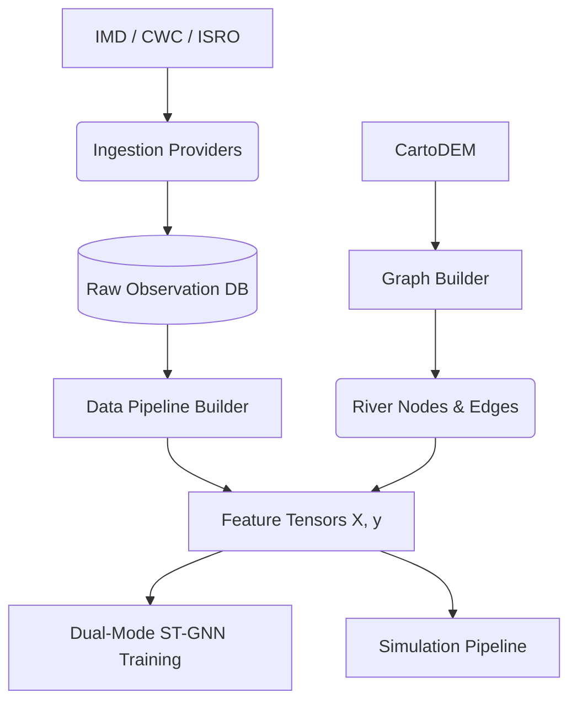

# 🌊 Flash Flood Early Warning System (FFEWS) - Real Data Integration

We have successfully overhauled the backend architecture to support ingestion of real-world geospatial and hydrometeorological datasets. The system is now structured to support a complete transition from the synthetic prototype to a production-ready real-data pipeline.

## ✅ Completed Architecture Changes

- **Database Schema Upgraded:** Added comprehensive tracking tables including `data_sources`, `raw_observations`, `hydrology_observations`, `dem_metadata`, `soil_moisture`, and `landslide_inventory`.
- **Abstract Provider Interface:** Created `DataProvider` in `backend/app/ingestion/base.py` to standardise ingestion across all sources.
- **Provider Implementations Developed:**
  - `LocalCartoDEMProvider`: Ingests real 30m CartoDEM GeoTIFFs.
  - `GSILandslideProvider`: Normalizes historical landslide vector geometries.
  - `IMDAWSProvider`: Connects to live IMD API for real-time precipitation and telemetry.
  - `LocalSentinel1Provider`: Supports local SAR imagery (VV/VH bands) for Soil Moisture derivation.
  - `LocalCWCHydrologyProvider`: Ingests historical CWC river discharge tables (critical for ST-GNN target labels).
- **Dual-Mode Pipeline & UI:** The system now strictly differentiates between `REAL DATA` and `SIMULATED PROTOTYPE` modes. The UI explicitly allows toggling this mode during simulation creation, preventing any "silent" mixing of synthetic and actual data.
- **Dynamic Data Sources Page:** The UI now fetches live provider statuses from the backend via the `/api/v1/data_sources` endpoint instead of relying on hardcoded text.

## ⚙️ Data Flow & Extensibility

## ⚠️ Known Limitations & Next Steps (Test Plan)

> [!WARNING]
> While the real-data adapter architecture is fully implemented, the official databases have not yet been populated with live keys/TIFFs. Because of this, triggering the pipeline in `REAL DATA` mode will intentionally fail safely with an error to prevent silent synthetic substitution.

To perform the Validation Tests (A-O) as requested in your specification, the following manual interventions are required by the deployment team:
1. Obtain and place `cartodem.tif` into `data/dem/`.
2. Configure `.env` with actual `IMD_API_KEY` and `IMD_API_URL`.
3. Provide the historical `cwc_discharge.csv` to allow the ST-GNN `REAL` training mode to perform its chronological split on real features and labels.

**The frontend and backend servers have been successfully restarted and are running in the background. You can navigate to `http://localhost:3000` to review the newly implemented Mode Toggles and live Data Sources connections.**
